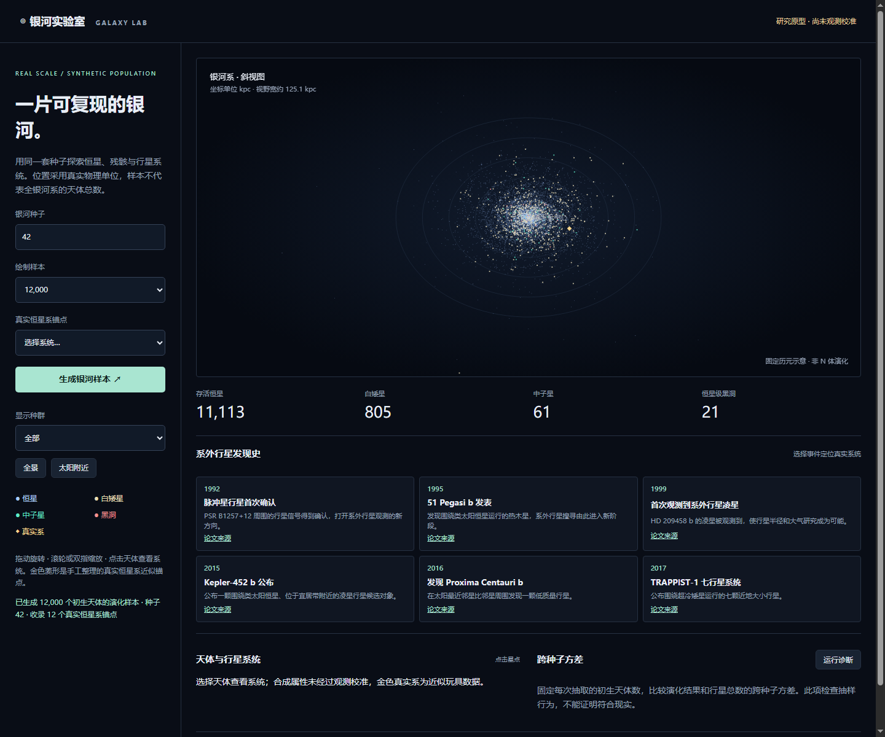

# 银河实验室 / Galaxy Lab

一个可重复生成、可交互浏览的玩具银河系原型。Python 3.9+（已在 Windows Python 3.9.16 验证），无第三方运行依赖。网页包含可旋转的三维投影、种群筛选、单星/行星系统查询和跨种子抽样诊断。另收录一小批可点击的真实恒星系锚点，例如太阳系、比邻星、TRAPPIST-1、飞马座51、HD 209458、开普勒-452 和 PSR B1257+12；这些是手工近似数据，不是实时目录。

[简体中文_](https://github.com/dddddd-0/galaxy-lab/edit/main/README.md) | [繁體中文](https://docs.maa.plus/zh-tw/) | [English_](https://github.com/dddddd-0/galaxy-lab/edit/main/en_.md) | [日本語](https://docs.maa.plus/ja-jp/) | [한국어](https://docs.maa.plus/ko-kr/)

<-!内视->

## 这版有什么

- 确定性的合成银河：同一种子、模型版本和对象编号得到同一颗天体。
- 可旋转/缩放/点击的 Canvas 三维投影，支持按恒星、白矮星、中子星、黑洞筛选。
- 单颗恒星的系统详情与行星轨道示意，行星数量带系统间离散。
- 跨种子抽样诊断，明确区分“抽样波动”和“现实校准”。
- 12 个真实恒星系锚点：金色菱形显示，可从左侧下拉框定位；含 1992 年首批脉冲星行星、1995 年首颗主序星系外行星等历史节点。
- 发现史时间线：1992–2017 年关键节点可点击定位到对应恒星系，并附论文链接。
- 数据来源页、近似坐标和玩具用途说明都写在界面内。

## Windows 启动

解压到 `J:\GalaxyLab`（或 J: 下空目录），双击 `start.cmd`，浏览器打开 http://127.0.0.1:8765 。Python 可用时直接执行 `python server.py`。端口被占用可用 `python server.py --port 8766`。

默认只监听本机。需要手机访问时显式执行 `python server.py --host 192.168.5.128`，然后在同一局域网打开 http://192.168.5.128:8765 。这不修改防火墙；网络访问仍取决于电脑现有配置。不要暴露到公网，内置 HTTP 服务仅供开发。

## 验证

`python -m unittest -v test_model.py`

`python validate.py`

验证涉及随机分布抽样矩、质量/轨道约束、固定编号和种子的可重复性、不同显示样本量的一致性、跨实例统计记账及 HTTP 输入限制。报告只验证实现和抽样行为，不等于天文学现实校准。

## 模型边界

- 每个合成编号代表一个初生单星的演化结果，不含双星系统，不能与恒星系统数混用。
- 采用分段幂律初始质量函数；年龄、星系组分权重、金属丰度和空间参数为示意设置。
- 恒星寿命采用幂律近似，不包含真实演化轨迹、巨星阶段、双星相互作用。残骸转换阈值和速度引起的位移只是示意，不是经校准的种群合成。
- 行星采用 Gamma-Poisson 强度、简化宿主依赖和轨道间距；未拟合真实发生率，未证明长期稳定性。残骸周围暂不生成行星。
- 坐标单位 kpc；轨道单位 AU；恒星质量单位太阳质量，行星质量单位地球质量。
- 太阳使用近似银河中心坐标 [8.2, 0, 0.0208] kpc；中心仅为坐标参考。二者不计入合成样本总数。
- 全景只是带真实单位的稀疏样本，不是全银河系逐天体人口，不从样本直接宣称现实总数。太阳邻域在放大后可能稀疏，尚无局部自适应生成。
- 没有导入 Gaia 巡天目录，没有巡天选择函数，也没有完整的观测复现模式；不生成伪造的“观测对象”。
- 真实恒星系只有 12 个，采用手工整理、四舍五入的近似参数；坐标由 J2000 赤经赤纬与距离换算，未做历元传播、视差误差和双星轨道。行星参数以来源页为准。
- 真实锚点与合成样本分开标记，不会计入合成天体数量，也不会改变合成样本的随机种子。
- 模型版本、种子、对象编号决定天体属性。改变参数或模型版本可以改变实例，查询次序和显示样本量不影响既有对象。
- 方差页固定初生样本量，衡量种子引起的抽样方差；尚不包含参数后验的不确定性。
- Canvas 提供交互三维坐标投影，不是 GPU 全量银河系渲染或 N 体模拟。

## 后续实现

先接入带版本和来源的太阳邻域目录，统一坐标历元、距离后验与误差，再做交叉匹配和巡天选择函数；对合成总体施加观测筛选以验证统计结果。手工真实锚点后续可替换为可复现的目录导入流程，但界面中的“玩具”和“未校准”标识应保留。随后加入校准后的恒星演化、双星模型、行星发生率，拓展空间分块与按需稳定生成。最终在一套数据模型内支持观测复现、条件补全和现实模板再生成。当前原型不宣称完成这些科学功能。

参考入口：

- https://arxiv.org/abs/astro-ph/0009005
- https://gea.esac.esa.int/archive/
- https://exoplanetarchive.ipac.caltech.edu/

以上是模型参考和计划数据入口，不表示本版本已下载并校准这些观测数据。
